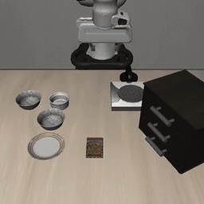
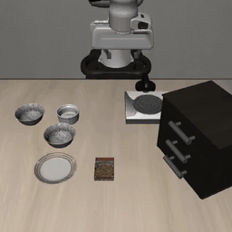

# PiQuant

Where does Pi0.5 spend its inference time on consumer GPUs, and does quantizing the bottleneck turn into a real speedup? DSC 180A group D38, mentored by [Zhijian Liu](https://github.com/zhijian-liu) ([Z-Lab](https://github.com/z-lab)).

## Data

- Model: [`lerobot/pi05_libero_finetuned`](https://huggingface.co/lerobot/pi05_libero_finetuned), Pi0.5 fine-tuned on LIBERO (about 14.5 GB, downloaded on first run)
- Benchmark: [LIBERO](https://libero-project.github.io/) simulated manipulation suites, run through [LeRobot](https://huggingface.co/docs/lerobot/libero)

## Requirements

- Linux with an NVIDIA GPU, since LIBERO requires Linux
- [uv](https://docs.astral.sh/uv/)
- CMake 3.x, to build LIBERO's `egl-probe` dependency, which fails to build under CMake 4. Without root: `uv tool install "cmake<4"`
- Python headers, because the checkpoint turns on `torch.compile` and its Triton backend compiles C against `Python.h`. A system Python often lacks them (`python3.12-dev` on Ubuntu). Without root, let uv use its own Python, which ships them: `uv sync --managed-python`

## Setup

```bash
git clone git@github.com:TheBoyRoy05/PiQuant.git
cd PiQuant
uv sync
```

## Run

Evaluate Pi0.5 on one LIBERO suite (default `libero_spatial`, 10 episodes per task):

```bash
scripts/eval_libero.sh libero_spatial 10
```

Print the latency floor of each Pi0.5 stage on each GPU and format (runs on CPU):

```bash
uv run python -m piquant.roofline
```

Measure the latency of each Pi0.5 stage on this GPU, next to its roofline floor (needs a GPU and the checkpoint):

```bash
uv run python -m piquant.profile                                # eager, per-stage breakdown
uv run python -m piquant.profile --steps 2                      # fewer denoising steps
uv run python -m piquant.profile --compile                      # the checkpoint's torch.compile, total only
uv run python -m piquant.profile --output outputs/profile.json  # keep every call's timings
```

## Demo

Two Pi0.5 rollouts on LIBERO-Spatial from our first baseline evaluation, played back in real time. On the left, the policy places the bowl on the plate in 3.9 s. On the right, it runs out the 280-step limit without completing the task.

<p align="center">
  
  
</p>

## Test

```bash
uv run pytest
```

## Report

The LaTeX report lives in `report/` and builds on Overleaf as is (upload the folder as a zip). To build it locally you need:

- A TeX distribution with XeLaTeX and latexmk: [MacTeX](https://www.tug.org/mactex/), [TeX Live](https://www.tug.org/texlive/) or [MiKTeX](https://miktex.org/) (MiKTeX also needs [Perl](https://strawberryperl.com/) for latexmk)
- The fonts the course style file loads: XCharter (ships with TeX Live and MacTeX), Arial and [Fira Code](https://github.com/tonsky/FiraCode)

```bash
cd report && latexmk report.tex
```

`report/.latexmkrc` selects XeLaTeX, so the VS Code LaTeX Workshop extension builds it on save.

## AI Use

We used AI assistants to research papers and hardware specifications, to write scripts and unit tests, and to draft the first version of the report, which we then revised ourselves. A person checked every number an AI produced against its source or our own measurements. We own every line of code and every sentence of the report. Every pull request into `main` needs an approval from at least one other teammate before it merges, so at least two of us have read and stand behind each change. The report's appendix describes our AI use in more detail.

## Contributing

See [CONTRIBUTING.md](CONTRIBUTING.md). To run on the NRP cluster, see [docs/nrp_kub_tutorial.md](docs/nrp_kub_tutorial.md).
